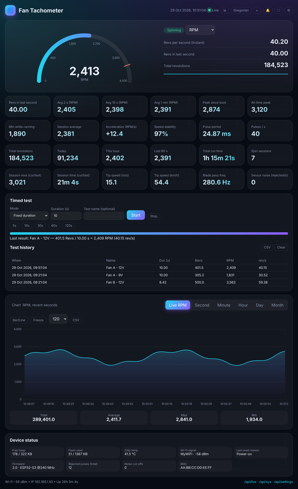
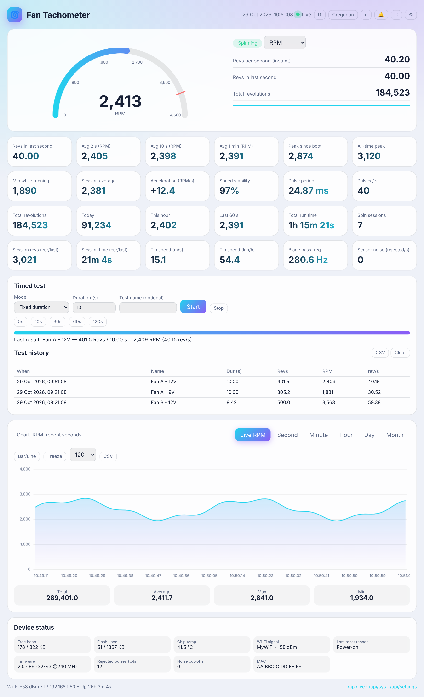
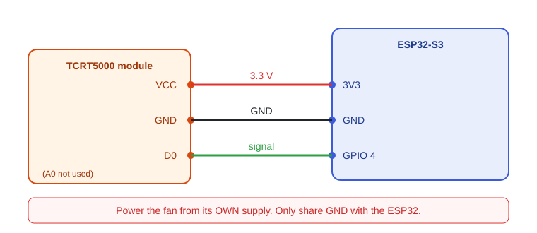

<div dir="rtl">

# 🌀 تاکومتر فن (ESP32-S3 + TCRT5000)

[English README](README.md)

یک **شمارنده‌ی دور فن** مستقل با داشبورد وب زنده. ESP32-S3 با یک سنسور مادون‌قرمز بازتابی ارزان (TCRT5000) هر دور فن را می‌شمارد
و خود برد یک داشبورد ریسپانسیو ارائه می‌دهد؛ بدون اینترنت، بدون کتابخانه‌ی اضافه و بدون نصب برنامه.

مثلاً جواب این سؤال‌ها را می‌دهد: «این فن در ۱۰ ثانیه چند دور می‌زند؟»، «با ۹ ولت و ۱۲ ولت چند RPM می‌شود؟»، «امروز چقدر چرخیده؟»

<p align="center">
  
  
</p>

> تصاویر بالا از همین صفحه‌ی داشبورد و با داده‌ی شبیه‌سازی‌شده گرفته شده‌اند.

## ✨ قابلیت‌ها

**اندازه‌گیری**
- RPM لحظه‌ای (از فاصله‌ی بین پالس‌ها) و میانگین ۲، ۱۰ و ۶۰ ثانیه
- دور بر ثانیه (Hz)، پالس بر ثانیه، شتاب (RPM/s) و پایداری سرعت
- بیشینه از روشن شدن، بیشینه تاریخی (ماندگار)، کمینه در حال چرخش، میانگین هر نوبت
- تشخیص «در حال چرخش / ایستاده» و آمار هر نوبت چرخش
- دور ۶۰ ثانیه‌ی اخیر، این ساعت، امروز و مجموع کل (ماندگار پس از خاموشی)
- سرعت نوک پره (m/s و km/h) و فرکانس عبور پره (اختیاری)
- واحدها: RPM، دور بر ثانیه، rad/s، deg/s
- ضریب کالیبراسیون و تعداد پالس در هر دور قابل تنظیم

**تست زمان‌دار**
- «تعداد دور در مدت مشخص» (مثلاً ۱۰ ثانیه) یا «زمان لازم برای N دور»
- نوار پیشرفت زنده، نام‌گذاری تست و تاریخچه‌ی ۲۰ تست آخر (ماندگار)
- خروجی CSV

**نمودار و تاریخچه**
- نمودار RPM زنده (۳۰ تا ۳۰۰ ثانیه‌ی اخیر؛ بدون نیاز به اینترنت)
- ثانیه، دقیقه (۶۰ دقیقه)، ساعت (۲۴ ساعت)، روز (۳۰ روز)، ماه (۱۲ ماه)
- ستونی/خطی، ثابت کردن نمودار، تولتیپ، آمار بازه
- تقویم شمسی یا میلادی

**هشدار و حفاظت**
- هشدار RPM بالا/پایین، توقف ناگهانی و نویز سنسور (بنر + بوق مرورگر + بیزر اختیاری)
- محافظ نویز: اگر سنسور وقفه‌ها را غرق کند، ۳ ثانیه قطع می‌شود تا ESP32 هنگ نکند
- تشخیص ریست ناشی از افت ولتاژ (Brownout)
- LED اختیاری که با هر پالس چشمک می‌زند

**داده و سیستم**
- خروجی CSV (ثانیه/دقیقه/ساعت/تست‌ها)، JSON و پشتیبان باینری
- تنظیمات و داده‌ها ماندگارند
- REST API کامل، mDNS (`http://fan-counter.local`)، به‌روزرسانی OTA، رمز اختیاری برای کارهای حساس
- هات‌اسپات جایگزین اگر به مودم وصل نشود
- وضعیت دستگاه: حافظه، فلش، دمای چیپ، سیگنال، علت ریست و نسخه

**رابط کاربری**
- فارسی (راست‌به‌چپ) و انگلیسی، تم تیره/روشن، سازگار با موبایل
- حالت نمایش بزرگ، میانبر کیبورد، نمایش RPM در عنوان تب، نمای چاپ

## 🧰 سخت‌افزار

| قطعه | توضیح |
|---|---|
| برد ESP32-S3 | روی ESP32-S3 توسعه داده شده |
| ماژول TCRT5000 (با LM393 و خروجی `D0`) | پایه‌ی `A0` استفاده نمی‌شود |
| نوار بازتابنده | یک تکه نوار آلومینیومی یا سفید روی یکی از پره‌ها یا هاب |
| فن + منبع تغذیه‌ی **جدا** | فن را هرگز از ESP32 تغذیه نکنید |
| خازن ۱۰۰ نانوفاراد (اختیاری) | بین VCC و GND سنسور برای کم کردن نویز |

### سیم‌کشی



| ماژول سنسور | ESP32-S3 |
|---|---|
| VCC | 3V3 |
| GND | GND |
| D0 | GPIO 4 |

GND منبع تغذیه‌ی فن **باید با GND ESP32 مشترک** باشد (فقط GND، نه پایه‌ی مثبت منبع).

### نکات مکانیکی (مهم‌تر از کد!)
1. **فقط یک** نوار بازتابنده روی پره یا هاب بچسبانید تا هر دور = یک پالس. اگر چند نوار چسباندید، «پالس در هر دور» را در تنظیمات عوض کنید.
2. سنسور را ۳ تا ۱۰ میلی‌متر از نوار فاصله دهید.
3. پتانسیومتر ماژول را طوری تنظیم کنید که LED روی ماژول با هر عبور نوار **دقیقاً یک بار** تغییر کند.
4. سیم‌ها را از پره‌ها دور نگه دارید.

## 🚀 راه‌اندازی

1. [Arduino IDE](https://www.arduino.cc/en/software) و بسته‌ی **esp32 by Espressif Systems** را نصب کنید. به کتابخانه‌ی اضافه نیازی نیست.
2. فایل `fan_rpm_pro/fan_rpm_pro.ino` را باز کنید.
3. بالای فایل، نام و رمز وای‌فای و منطقه‌ی زمانی را تنظیم کنید:
   ```cpp
   const char* WIFI_SSID = "YOUR_WIFI_NAME";
   const char* WIFI_PASS = "YOUR_WIFI_PASSWORD";
   const char* DEFAULT_TZ = "<+0330>-3:30";   // ایران
   ```
4. برد را روی **ESP32S3 Dev Module** بگذارید و آپلود کنید.
5. سریال مانیتور (۱۱۵۲۰۰) آدرس را چاپ می‌کند، مثلاً `http://fan-counter.local`. آن را در مرورگرِ همان شبکه باز کنید.

اگر ۲۰ ثانیه بعد به مودم وصل نشد، برد یک هات‌اسپات باز به نام **`Fan-Counter`** می‌سازد؛ به آن وصل شوید و `http://192.168.4.1` را باز کنید.

> آمار دقیقه/ساعت/روز به همگام شدن ساعت از اینترنت (NTP) نیاز دارد. گیج، RPM زنده، نمودار ثانیه‌ای و تست‌ها بدون اینترنت هم کار می‌کنند.

## 🛠 تنظیمات

ثابت‌های بالای اسکچ: `SENSOR_PIN` (پیش‌فرض ۴)، `LED_PIN` و `BUZZER_PIN` (پیش‌فرض `-1` یعنی خاموش)، `HOSTNAME`، `SAVE_EVERY_MS` (ذخیره‌ی خودکار هر ۵ دقیقه)، `NOISE_LIMIT`.

تنظیمات داخل داشبورد (⚙): پالس در هر دور، تعداد پره‌ها، شعاع پره، دیبانس (µs)، ضریب کالیبراسیون، زمان تشخیص توقف، هشدار RPM بالا/پایین، بیزر، لاگ سریال، منطقه‌ی زمانی، رمز و نرخ به‌روزرسانی.

**بیشینه‌ی سرعت قابل اندازه‌گیری** ≈ `۶۰٬۰۰۰٬۰۰۰ ÷ (دیبانس بر حسب µs × پالس در هر دور)` دور بر دقیقه. با مقادیر پیش‌فرض ۲۰۰٬۰۰۰ RPM است؛ محدودیت واقعی خود سنسور است (چند کیلوهرتز).

## 🔌 REST API

جزئیات کامل جدول endpointها در [README انگلیسی](README.md#-rest-api) آمده است. مهم‌ترین‌ها:

- `GET /api/live` — همه‌ی مقادیر زنده
- `GET /api/series?res=rpm|second|minute|hour|day|month` — داده‌ی نمودار
- `POST /api/test/start` با `mode=time|revs` و `value=…` — شروع تست
- `GET /api/export?what=bin|json|tests|rpm|minutes|hours` — دانلود داده

اگر رمز تنظیم شده باشد، عملیات تغییردهنده با Basic Auth و نام کاربری **`admin`** محافظت می‌شوند.

## 🩺 رفع اشکال

| مشکل | راه‌حل |
|---|---|
| فن یا ESP32 در سرعت بالا خاموش می‌شود | فن را از منبع جدا تغذیه کنید و فقط GND را مشترک بگیرید؛ خازن ۱۰۰nF روی سنسور بگذارید |
| RPM دو برابر/نصف یا اشتباه است | تنظیم «پالس در هر دور» را بررسی کنید و ببینید LED ماژول در هر دور یک بار تغییر می‌کند |
| RPM می‌پرد | پتانسیومتر را تنظیم کنید، نوار تمیز بچسبانید یا دیبانس را زیاد کنید |
| داشبورد باز نمی‌شود | به‌جای `.local` از IP سریال مانیتور استفاده کنید یا به هات‌اسپات وصل شوید |
| نمودار دقیقه/ساعت/روز خالی است | ساعت همگام نشده (اینترنت ندارد)؛ بقیه‌ی بخش‌ها کار می‌کنند |
| وای‌فای وصل نمی‌شود | ESP32 فقط شبکه‌ی ۲٫۴ گیگاهرتز را پشتیبانی می‌کند |

## 📄 مجوز

[MIT](LICENSE)

</div>
